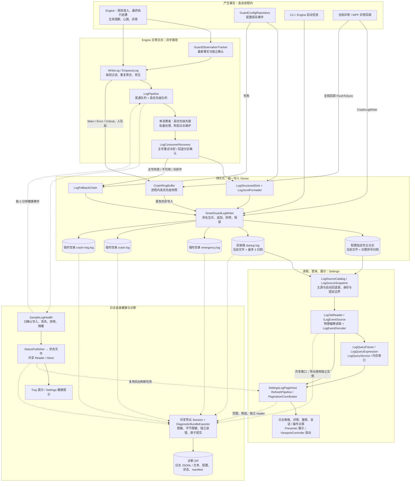
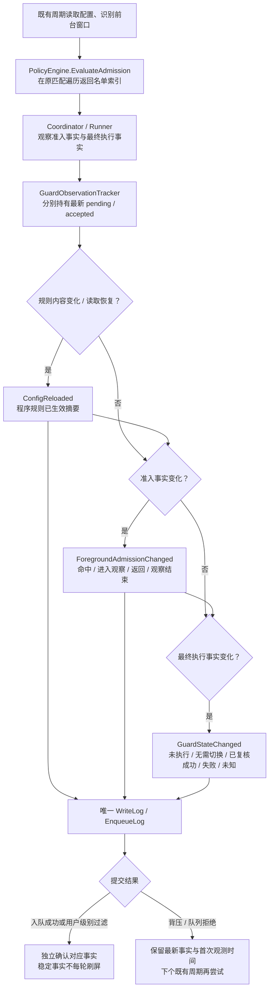
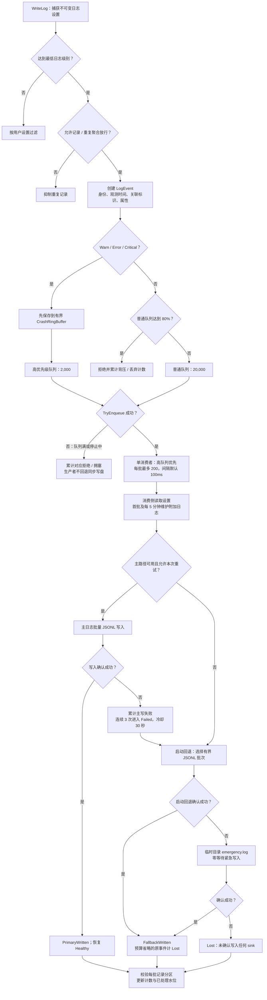
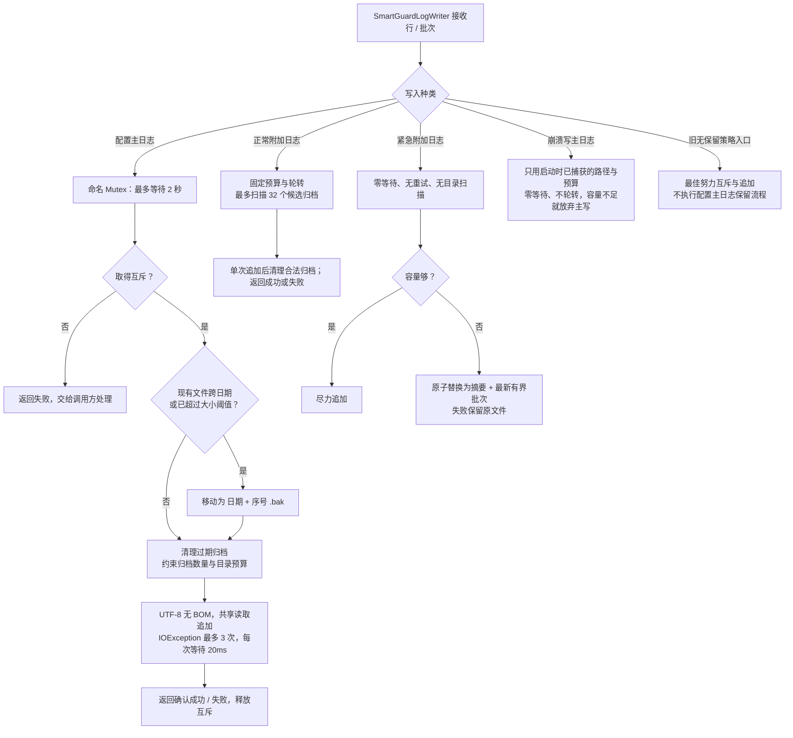
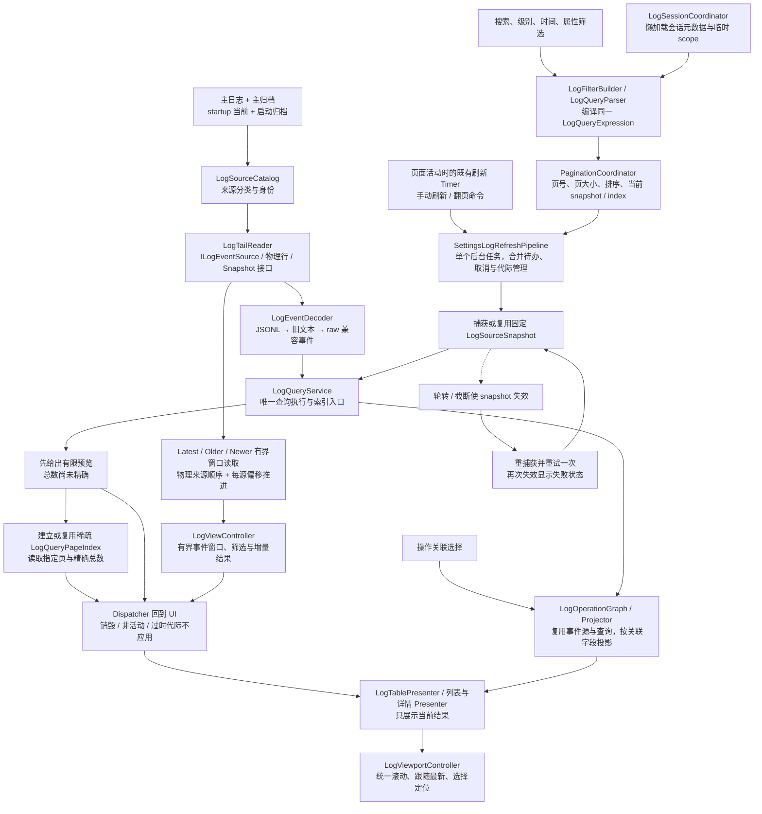
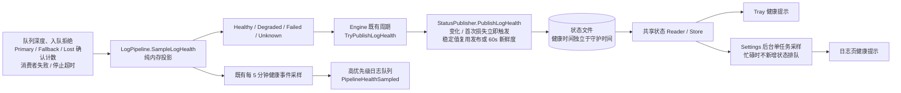
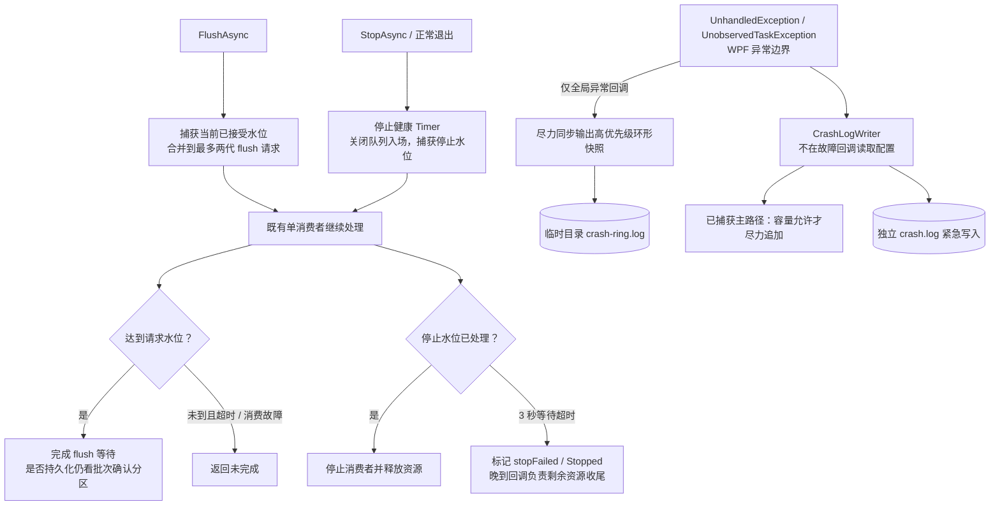
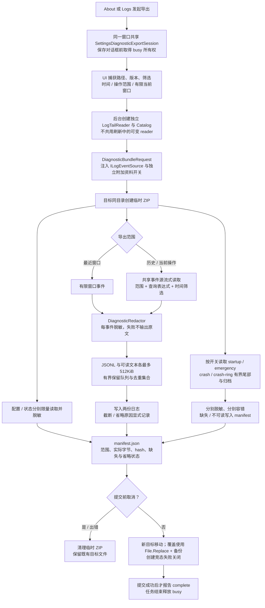

# 当前日志系统架构与运行流程

核对日期：2026-10-05。源码基线：1.6.3，提交 `5c360860`。本文描述当前实现；属于源码核对与架构说明，不代表本轮重新执行了运行验收。权威约束仍见 [架构契约](ARCHITECTURE-CONTRACT.md)。

阅读顺序：先看总架构，再按需要展开后面的运行流程。实线表示数据或调用，虚线表示状态观测、共享输入或辅助路径。图中的名称对应当前代码，不包含未来规划。

## 1. 完整架构总览

三条边界需要保留：**队列属于 Engine 日常路径，并非所有进程共用的日志服务**；设置页正常读取主日志与启动回退历史，不自动合并全部临时目录日志；日志健康通过独立的状态文件链路展示，因此主日志写不进去时仍有另一条观测路径，但状态文件自身也可能失败。

## 2. 程序规则命中与动作结果如何变成日志

这些事件跳过普通“相同消息”去重，由事实跟踪器负责语义去重；准入和执行分别确认。规则或权限门发生变化、新准入覆盖旧准入时，会淘汰过时执行结果。跟踪器不决定电源动作，也不保存窗口历史。程序事件只记有界文件名和规则索引，不记完整程序路径。

观察期的日志表达：从名单程序切到名单外才进入观察；默认 180 秒，期间不自动执行；返回名单立即恢复检测；到期仍未命中则保留当前电源计划。**命中日志证明准入事实；动作是否执行、是否生效，要看最终结果事件。**

## 3. Engine 写入、背压与故障回退

30 秒冷却不是一个额外重试线程：后续批次到来时才检查能否再次尝试主写。没有有效主配置时直接回退，不计为主写失败。高优先级只绕过普通队列的提前背压，仍可能因高队列已满而被拒绝；环形缓冲也不保证进程被强杀时能够落盘。

消费者回退保留规范 JSONL、事件身份与属性；同步的单事件辅助回退可能写带 `LOG-FALLBACK` / `LOG-EMERGENCY` 标记的文本。读端通过兼容解码统一为事件。

## 4. 文件追加、轮转与保留

主日志的大小判断发生在追加前，判断的是现有文件大小；因此 1MiB 默认值是轮转阈值，不是每次写完都保证不超过的硬上限。主日志目录保留会枚举对应归档，不能把附加日志“最多 32 候选”的限制套到主日志上。

## 5. 查询、分页、筛选与界面刷新

当前表格分页以固定 snapshot 和稀疏页索引为主；控制器仍提供有限窗口与尾部读取能力，二者共用事件源和查询契约，不是两套文件解析器。筛选、会话与操作范围组合到既有表达式，不复制完整事件历史。

顺序尾读的游标按物理来源及偏移推进，展示按事件时间；时间回拨或同秒日志不意味着“没有新行”。主源和启动回退中的同一 `eventId` 在当前页 / 有界窗口内去重，不建立全历史身份集合。表格页排序与物理扫描游标是不同职责。

## 6. 日志自身健康与故障可见性

健康计数不因采样清零。“Failed”可能来自丢失、消费者故障或关闭超时；“Degraded”包含回退或当前拥塞；未确认写入、缺失或不可信的状态不能显示为健康。主写恢复状态机和界面健康代码是两个不同概念：主写还处于冷却时，回退已写入仍是降级。

## 7. 关闭、Flush 与崩溃路径

正常关闭尽力排空已接受事件，不保证因底层写入失败而丢失的事件重新落盘。崩溃路径绕开日常队列；全局回调会输出环形快照，WPF 回调另有直接崩溃记录。强制终止、断电或回调未被执行不能保证留下崩溃资料。`FlushOnce` 是冷态 / 测试用同步路径，不是运行期第二个消费者。

## 8. 诊断包导出运行流程

Request 默认仅开启启动日志附带；另外三个开关默认关闭。**About 的当前入口会默认附带四类资料**，不能把 Request 类型默认值误当成所有 UI 的默认选择。导航离开来源页或关闭窗口可取消，晚到结果不更新已销毁 / 非活动页面；取消不能保证立即中断底层同步 OS 调用。

## 9. 数据模型与默认资源边界

| 项目 | 当前事实 / 默认值 | 说明 |
|---|---|---|
| 规范记录 | `LogEvent`，schemaVersion 1 | eventId、时间、级别、组件、通道、事件名、消息、异常、PID/TID、关联标识、properties |
| 关联字段 | OperationId / TraceId / SpanId / UserActionId | 用于关联；不是物理分页游标，且不是每条事件都有 |
| 主格式 | JSONL，时间使用 UTC round-trip | UTF-8 无 BOM；旧文本通过兼容解码读取 |
| 普通 / 高队列 | 20,000 / 2,000 条 | 非阻塞 TryEnqueue；满或停止中可以拒绝 |
| 普通背压 | 普通容量的 80% | 提前拒绝普通事件；高队列仍有容量上限 |
| 消费批量 / 等待 | 200 条 / 100ms | 高优先级先取；不是每条 100ms 落盘保证 |
| Flush / Stop 等待 | 默认 3,000ms | 等待边界，不等于所有 OS IO 必定 3 秒内结束 |
| 主写恢复 | 连续失败 3 次；冷却 30 秒 | 后续批次触发探测，无额外重试线程 |
| 主日志配置默认 | 1MiB 阈值、7 天、30 归档、100MiB 目录预算 | 来自 GuardConfig；可配置，非当前用户配置实测值 |
| 附加日志固定预算 | 当前 1MiB、3 归档、7 天、单批 128KiB | 正常维护完成每类 4MiB；目录候选扫描至多 32 |
| 崩溃内存环 | 默认 500 条，单条 4KiB，总计 2MiB | 覆盖最旧记录；只保留高优先级近期快照 |
| 尾读默认请求 | 200 事件 / 256KiB | 不等于表格页大小或完整历史上限 |
| 查询表达式 | 最长 4,096 字符、AST 深度 32 | 查询复用唯一解析 / 执行入口 |
| 主日志诊断输出 | JSONL / 文本每份最多 512KiB | 按脱敏后的 UTF-8 字节与换行计算 |
| 附加诊断尾读 | 260KiB 读取 / 256KiB 输出 | 活动文件与最多 3 归档共用预算 |
| 配置 / 状态诊断读取 | 8MiB / 256KiB | 独立容错；脱敏失败不回退原文 |

主日志路径由配置及 `SmartGuardPaths.ResolveLogFile` 决定；启动日志由 `SmartGuardPaths.StartupLogFile` 决定；三类 emergency / crash / crash-ring 文件使用当前进程 `%TEMP%\SmartGuard`。不同运行账户的临时目录可能不同，不能假定它们总在同一物理目录。

## 10. 源码与责任对照

| 责任 | 当前实现 |
|---|---|
| 路径与配置 | [SmartGuardPaths](../src/SmartGuard.Configuration/SmartGuardPaths.cs)、[GuardConfig](../src/SmartGuard.Configuration/GuardConfig.cs)、[GuardConfigRepository](../src/SmartGuard.Configuration/GuardConfigRepository.cs) |
| 规则事实与确认 | [GuardObservationTracker](../src/SmartGuard.Engine/Worker/GuardObservationTracker.cs) |
| Engine 日志入口与消费集成 | [GuardianLoop.Logging](../src/SmartGuard.Engine/Worker/GuardianLoop.Logging.cs)、[GuardianLoop](../src/SmartGuard.Engine/Worker/GuardianLoop.cs) |
| 队列、生命周期、确认计数 | [LogPipeline](../src/SmartGuard.Configuration/LogPipeline.cs)、[LogPipelineOptions](../src/SmartGuard.Configuration/LogPipelineOptions.cs)、[LogBackpressureController](../src/SmartGuard.Configuration/LogBackpressureController.cs) |
| 主写恢复与回退 | [LogConsumerRecovery](../src/SmartGuard.Engine/Infrastructure/LogConsumerRecovery.cs)、[LogRecoveryStateMachine](../src/SmartGuard.Engine/Infrastructure/LogRecoveryStateMachine.cs)、[LogFallbackChain](../src/SmartGuard.Configuration/LogFallbackChain.cs) |
| 结构化记录与格式 | [LogEvent](../src/SmartGuard.Configuration/LogEvent.cs)、[LogStructuredSink](../src/SmartGuard.Configuration/LogStructuredSink.cs)、[LogJsonlFormatter](../src/SmartGuard.Configuration/LogJsonlFormatter.cs) |
| 物理写入与保留 | [SmartGuardLogWriter](../src/SmartGuard.Configuration/SmartGuardLogWriter.cs)、[Supplemental partial](../src/SmartGuard.Configuration/SmartGuardLogWriter.Supplemental.cs)、[SupplementalLogPolicy](../src/SmartGuard.Configuration/SupplementalLogPolicy.cs)、[LogArchivePlanner](../src/SmartGuard.Configuration/LogArchivePlanner.cs) |
| 崩溃路径 | [GlobalExceptionHandlers](../src/SmartGuard.Configuration/GlobalExceptionHandlers.cs)、[CrashLogWriter](../src/SmartGuard.Configuration/CrashLogWriter.cs)、[CrashRingBuffer](../src/SmartGuard.Configuration/CrashRingBuffer.cs) |
| 来源 / 解码 / 尾读 | [LogSourceCatalog](../src/SmartGuard.Configuration/LogSourceCatalog.cs)、[LogSourceSnapshot](../src/SmartGuard.Configuration/LogSourceSnapshot.cs)、[LogEventDecoder](../src/SmartGuard.Configuration/LogEventDecoder.cs)、[LogTailReader](../src/SmartGuard.Settings/LogView/LogTailReader.cs) |
| 查询与索引 | [LogQueryService](../src/SmartGuard.Configuration/LogQueryService.cs)、[LogQueryParser](../src/SmartGuard.Configuration/LogQueryParser.cs)、[LogIndexBuilder](../src/SmartGuard.Configuration/LogIndexBuilder.cs) |
| 页面任务 / 分页 / 滚动 | [SettingsLogPageHost](../src/SmartGuard.Settings/SettingsLogPageHost.cs)、[Refresh partial](../src/SmartGuard.Settings/SettingsLogPageHost.Refresh.cs)、[SettingsLogRefreshPipeline](../src/SmartGuard.Settings/SettingsLogRefreshPipeline.cs)、[SettingsLogPaginationCoordinator](../src/SmartGuard.Settings/SettingsLogPaginationCoordinator.cs)、[LogViewportController](../src/SmartGuard.Settings/LogViewportController.cs) |
| 诊断导出 | [DiagnosticBundleRequest](../src/SmartGuard.Configuration/DiagnosticBundleRequest.cs)、[DiagnosticBundleExporter](../src/SmartGuard.Configuration/DiagnosticBundleExporter.cs)、[Files partial](../src/SmartGuard.Configuration/DiagnosticBundleExporter.Files.cs)、[DiagnosticLogTailReader](../src/SmartGuard.Configuration/DiagnosticLogTailReader.cs)、[DiagnosticRedactor](../src/SmartGuard.Configuration/DiagnosticRedactor.cs) |

已退役的统计聚合服务、统计面板与错误趋势图不在当前链路中。本图不把入队接受当作磁盘确认，不把高优先级当作绝不丢失，也不把诊断脱敏描述成运行日志写入前的统一脱敏。
